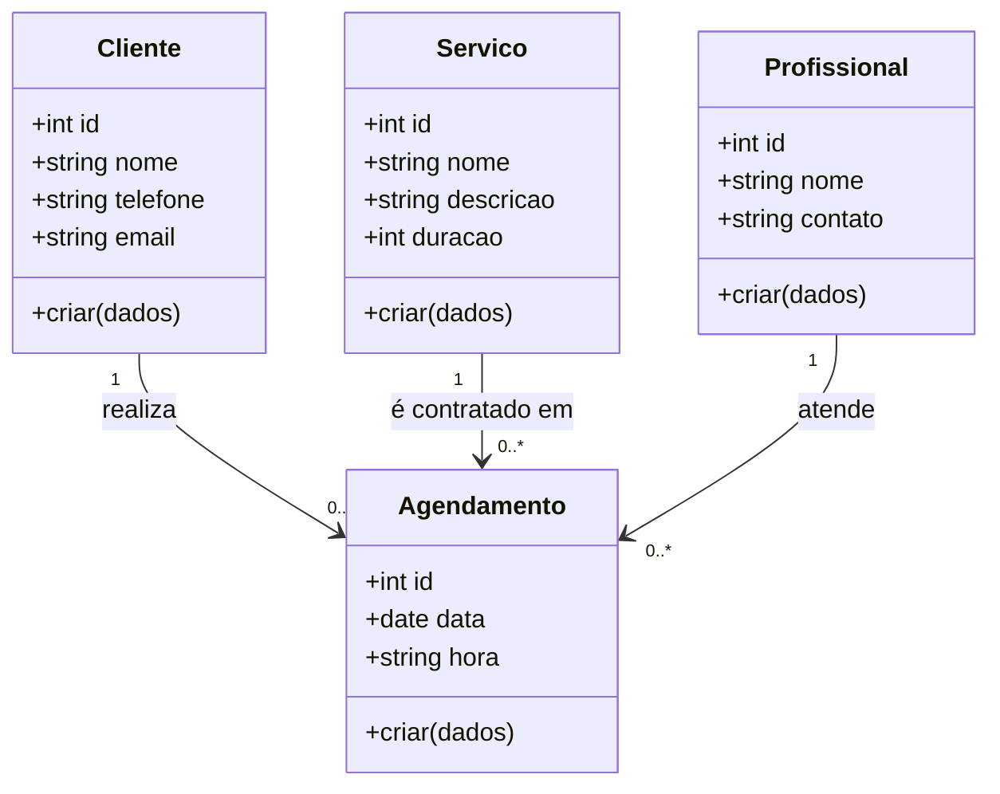
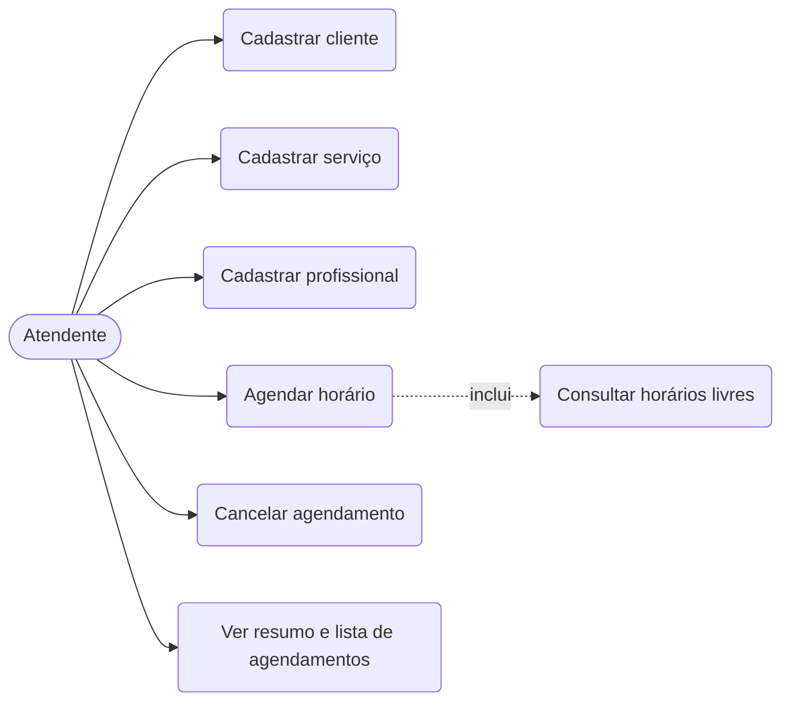
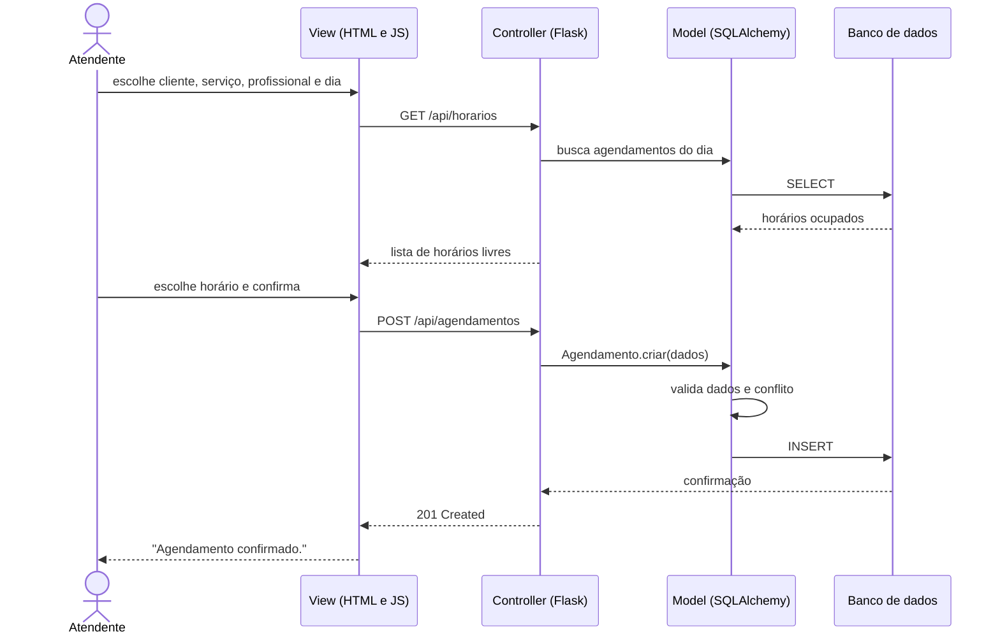
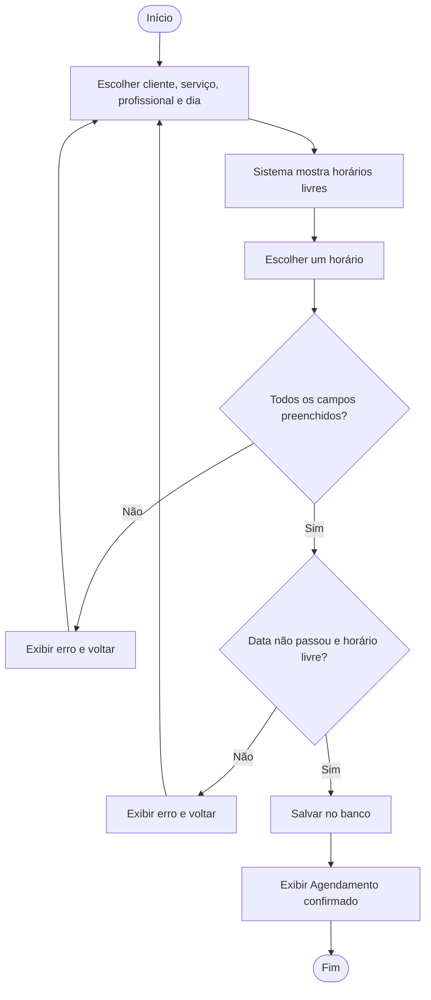

# Diagramas UML

Os diagramas usam Mermaid e aparecem desenhados direto no GitHub.

## Diagrama de classes

## Casos de uso
O Mermaid não tem diagrama de casos de uso nativo, então foi desenhado como fluxo com o ator à esquerda.

## Diagrama de sequência: agendar horário

## Diagrama de atividades: agendar horário

