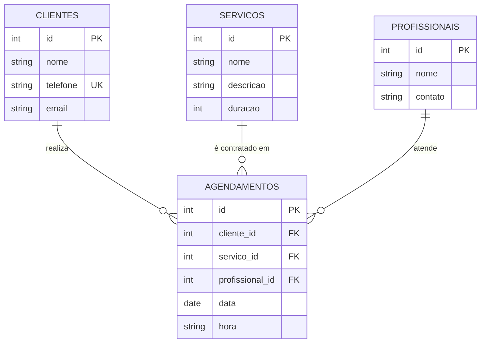

# Modelo de dados

## Projeto conceitual (DER)


## Projeto lógico (esquema relacional)
- clientes (**id**, nome, telefone, email)
- servicos (**id**, nome, descricao, duracao)
- profissionais (**id**, nome, contato)
- agendamentos (**id**, *cliente_id*, *servico_id*, *profissional_id*, data, hora)
  - FK: cliente_id → clientes.id; servico_id → servicos.id; profissional_id → profissionais.id
  - Chave única: (profissional_id, data, hora)

### Normalização
- **1FN:** todos os atributos são atômicos e não há grupos repetidos.
- **2FN:** todas as tabelas têm chave primária simples (id), então não há dependência parcial.
- **3FN:** nome do cliente, do serviço e do profissional não são repetidos em agendamentos. Eles são obtidos
  pela chave estrangeira, então não há dependência transitiva.

## Projeto físico (PostgreSQL)
```sql
CREATE TABLE clientes (
    id        SERIAL PRIMARY KEY,
    nome      VARCHAR(100) NOT NULL,
    telefone  VARCHAR(20)  NOT NULL UNIQUE,
    email     VARCHAR(120)
);

CREATE TABLE servicos (
    id         SERIAL PRIMARY KEY,
    nome       VARCHAR(100) NOT NULL,
    descricao  VARCHAR(200),
    duracao    INTEGER NOT NULL
);

CREATE TABLE profissionais (
    id       SERIAL PRIMARY KEY,
    nome     VARCHAR(100) NOT NULL,
    contato  VARCHAR(120)
);

CREATE TABLE agendamentos (
    id               SERIAL PRIMARY KEY,
    cliente_id       INTEGER NOT NULL REFERENCES clientes(id),
    servico_id       INTEGER NOT NULL REFERENCES servicos(id),
    profissional_id  INTEGER NOT NULL REFERENCES profissionais(id),
    data             DATE NOT NULL,
    hora             VARCHAR(5) NOT NULL,
    CONSTRAINT uq_horario_profissional UNIQUE (profissional_id, data, hora)
);
```
Na aplicação, as tabelas são criadas automaticamente pelo SQLAlchemy (`db.create_all()`), a partir de `models.py`.
