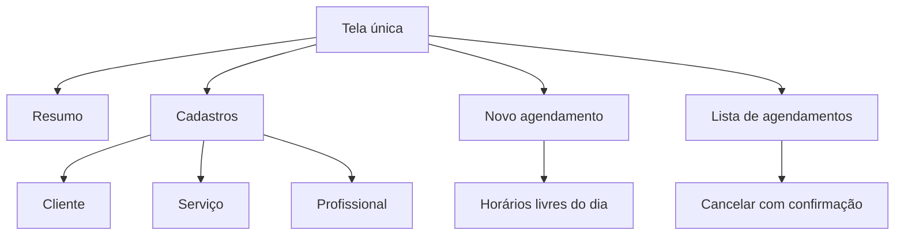

# IHC: telas, mensagens e princípios

## Telas
O sistema tem uma tela única, dividida em áreas:
1. **Cabeçalho:** título e descrição do sistema.
2. **Faixa de aviso:** mensagens de sucesso (verde) e de erro (vermelho).
3. **Resumo:** quatro cartões com os totais.
4. **Cadastros:** cliente, serviço e profissional lado a lado.
5. **Novo agendamento:** seleção de cliente, serviço, profissional, dia e horário.
6. **Agendamentos:** lista ordenada por data, com botão de cancelar.

## Mapa conceitual de navegação

## Mensagens do sistema
| Situação | Mensagem |
|---|---|
| Nome do cliente vazio | Informe o nome do cliente. |
| Telefone vazio | Informe o telefone. |
| Telefone sem DDD | Informe um telefone com DDD. |
| E-mail fora do formato | E-mail inválido. |
| Telefone repetido | Já existe um cliente com esse telefone. |
| Nome do serviço vazio | Informe o nome do serviço. |
| Duração inválida | Informe uma duração válida. |
| Duração menor que 5 | A duração mínima é 5 minutos. |
| Nome do profissional vazio | Informe o nome do profissional. |
| Cliente, serviço ou profissional não selecionado | Selecione um cliente (serviço, profissional) válido. |
| Data inválida | Escolha uma data válida. |
| Data que já passou | Não é possível agendar em uma data que já passou. |
| Horário não escolhido | Escolha um horário livre. |
| Horário ocupado | Esse horário já está ocupado para o profissional. |
| Agendamento inexistente | Agendamento não encontrado. |
| Conflito no banco | Não foi possível salvar: registro duplicado ou inválido. |
| Sucesso | Cliente salvo. / Serviço salvo. / Profissional salvo. / Agendamento confirmado. / Agendamento cancelado. |

## Princípios de interface aplicados (material da disciplina)
- **Clara e simples:** uma tela só, com rótulos diretos.
- **Consistente:** os três cadastros têm o mesmo layout e botão no mesmo lugar.
- **Dá resposta:** toda ação mostra uma mensagem de sucesso ou de erro.
- **Reversível e empática:** o cancelamento pede confirmação, e o horário volta a ficar livre.
- **Direta:** horários ocupados aparecem riscados e desativados.
- **Esteticamente agradável:** cores com contraste, tipografia com hierarquia e tema claro e escuro.

## Melhorias de IHC identificadas (para o ciclo de melhoria contínua)
1. Destacar o "Novo agendamento" no topo e adicionar atalho "+ Novo cliente".
2. Mostrar o aviso próximo ao botão clicado, não só no topo.
3. Adicionar legenda dos horários (livre, ocupado, selecionado) e esconder horários que já passaram hoje.
4. Separar "Próximos" e "Histórico" na lista, com filtros.
5. Permitir editar e excluir cadastros.
